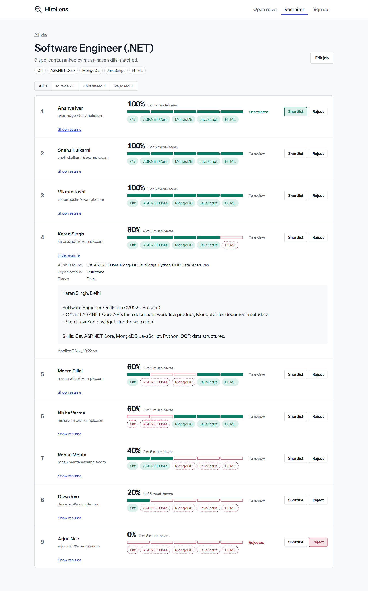
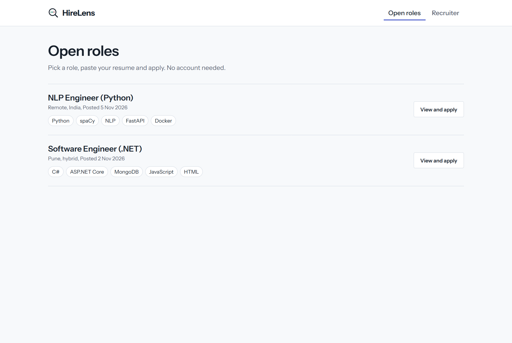
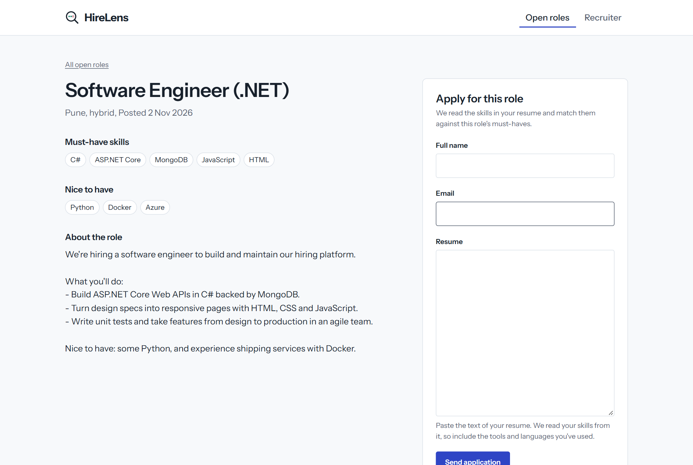
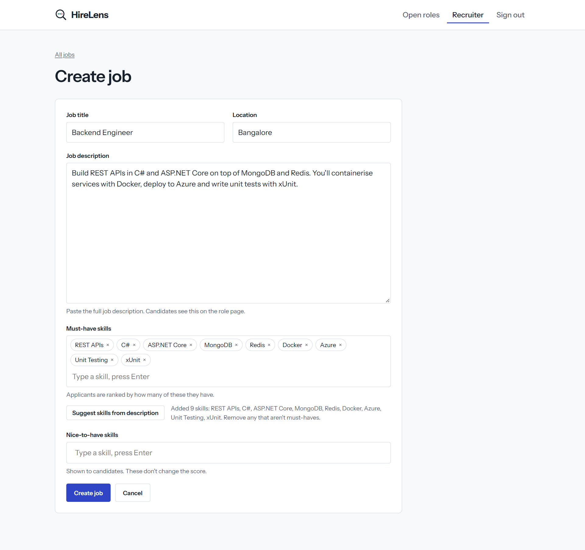
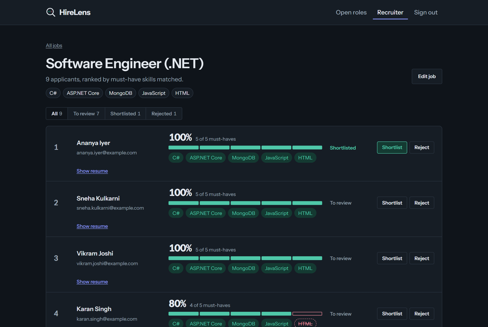
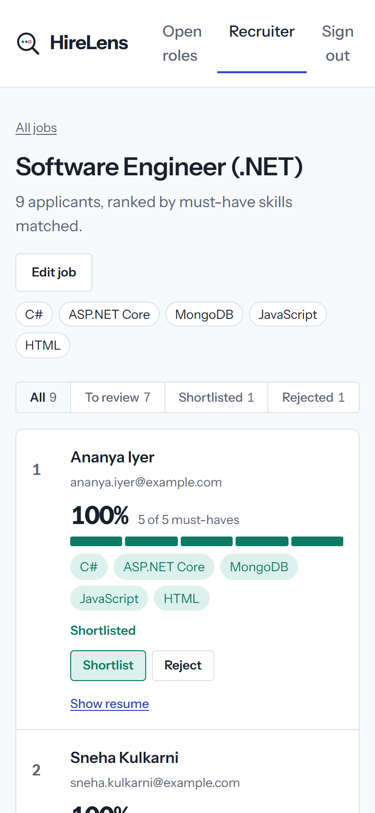
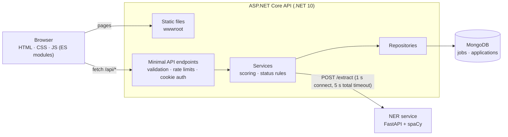

# HireLens

A small applicant screener. A recruiter posts a job, candidates apply by pasting their resume, a Python NER service pulls the skills out of the text, and the recruiter sees applicants **ranked by how many must-have skills they have**, with exactly which ones matched and which are missing.

Built with **ASP.NET Core (.NET 10, C#)**, **plain HTML/CSS/JavaScript**, **MongoDB**, and **Python (FastAPI + spaCy)**.



## What it does

1. **The recruiter creates a job** by pasting a job description. "Suggest skills" runs it through NER and fills in the must-have skills, which the recruiter confirms or edits.
2. **A candidate applies** with their name, email and pasted resume text. NER extracts their skills, organisations, places and dates, and the app saves a match score.
3. **The recruiter sees applicants ranked by score**, with matched and missing skills for each, can read the resume, and shortlists or rejects.

**Score = must-have skills matched ÷ total must-have skills.** It's easy to explain: a 60% is visibly "3 of 5, missing ASP.NET Core and MongoDB".

| Candidate: open roles | Candidate: apply | Recruiter: suggested skills |
|---|---|---|
|  |  |  |

| Dark mode | Phone |
|---|---|
|  |  |

## Architecture



- **One deployable for the web app**: the API serves the frontend from `wwwroot`, so there's no separate frontend server and no build step.
- **NER is a separate Python service** because spaCy only exists in Python. If it's down, applying still works: the application is saved with `nerStatus: "pending"`, and the recruiter retries with one click.
- **MongoDB** because the core entity, a resume plus its extracted entities, is an irregular, nested document read and written whole. The full argument, including when PostgreSQL would be the better choice, is in [DECISIONS.md](DECISIONS.md).

### Data model

```js
// jobs
{ _id, title, location, descriptionText, mustHaveSkills: ["C#", "MongoDB"], niceToHaveSkills: ["Python"],
  status: "open" | "closed", createdAt }

// applications: one document per application; references its job by jobId (a job can get unlimited applications)
{ _id, jobId, name, email, resumeText,
  nerStatus: "done" | "pending", skills: ["C#", "JavaScript"], entities: { orgs, locations, dates },
  score: 0.75, matched: ["C#"], missing: ["MongoDB"],
  status: "applied" | "shortlisted" | "rejected",
  statusHistory: [{ status, at }],          // embedded: small, bounded, always read with the application
  createdAt }
```

Indexes, created at startup:

| Index | Serves |
|---|---|
| `{ jobId: 1, score: -1, createdAt: 1 }` | The ranked applicant list, with no in-memory sort (ties go to whoever applied first) |
| `{ skills: 1 }` (multikey) | "Which candidates know X?" |
| `{ jobId: 1, email: 1 }` unique | One application per person per job |

### Performance: the ranked-list index

Measured with [`tools/benchmark/ranked-query.js`](tools/benchmark/ranked-query.js): 50,000 applications across 100 jobs, fetching one job's 500 applicants in ranked order (the exact query the app sends), 25 runs each, local MongoDB 8.0.

| | Median | p95 | Documents examined | Plan |
|---|---|---|---|---|
| No index | 45 ms | 97 ms | 50,000 | `COLLSCAN` → in-memory `SORT` |
| `{ jobId, score, createdAt }` | **12 ms** | **20 ms** | **500** | `IXSCAN` → `FETCH` (already sorted) |

Documents examined drop 100× and the in-memory sort is gone, so query cost tracks the size of one job's list, not the whole collection. Most of the remaining 12 ms is returning the 500 documents.

## Running it

**Prerequisites:** .NET 10 SDK and Docker Desktop. The first build of the NER image takes a few minutes, because it downloads spaCy and its model.

### Everything in Docker

```bash
docker compose up -d --build
```

Open http://localhost:8080. It starts empty. To load the demo data (2 jobs, 15 fictional applicants), run the seeder. The stack publishes MongoDB and NER on their default local ports, so no settings are needed:

```bash
dotnet run --project src/HireLens.Api -- seed
```

### For development (hot reload, Scalar API docs)

```bash
docker compose up -d mongo ner                      # dependencies only
dotnet run --project src/HireLens.Api -- seed       # optional demo data (add --reset to replace existing data)
dotnet run --project src/HireLens.Api               # http://localhost:5063
```

| URL | What |
|---|---|
| http://localhost:5063 | Candidate site: open roles, apply |
| http://localhost:5063/recruiter/ | Recruiter: jobs, ranked applicants (sign-in required) |
| http://localhost:5063/scalar | Interactive API docs (Development only) |
| http://localhost:5063/health | Health check (pings MongoDB) |

**Recruiter sign-in (development):** `recruiter@hirelens.dev` / `dev-recruiter-pass-2026`. This account is defined in `appsettings.Development.json` and Docker Compose's defaults, and is for local use only.

To use your own recruiter account, generate a password hash and set two environment variables:

```bash
dotnet run --project src/HireLens.Api -- hash-password     # prompts for the password, prints the hash
# then: Recruiter__Email=you@company.com  Recruiter__PasswordHash=<hash>
# with Docker Compose: RECRUITER_EMAIL=... RECRUITER_PASSWORD_HASH=... docker compose up -d
```

### Configuration

| Setting (env var) | Default | Purpose |
|---|---|---|
| `Mongo__ConnectionString` | `mongodb://localhost:27017` | MongoDB connection |
| `Mongo__DatabaseName` | `hirelens` | Database name |
| `Ner__BaseUrl` | `http://127.0.0.1:8000` | NER service |
| `Ner__TimeoutSeconds` / `Ner__ConnectTimeoutSeconds` | `5` / `1` | Total and connect timeouts for NER calls |
| `Ner__ApiKey` | *(empty)* | Sent as `X-Api-Key`; must match the NER service's `NER_API_KEY` if that's set |
| `Recruiter__Email` / `Recruiter__PasswordHash` | *(dev values in Development)* | The one recruiter account |
| `RateLimiting__{Apply,SuggestSkills,Login}__PermitLimit` | `5` / `20` / `5` per minute per IP | Rate limits |

## Pages

| Page | Who | What it does |
|---|---|---|
| `/` | Candidate | Open roles with their must-have skills |
| `/job.html?id=…` | Candidate | Role details and the application form |
| `/login.html` | Recruiter | Sign in |
| `/recruiter/` | Recruiter | Jobs, filterable by open / closed / all |
| `/recruiter/job.html[?id=…]` | Recruiter | Create or edit a job, suggest skills from the description, close or reopen it |
| `/recruiter/applicants.html?jobId=…` | Recruiter | Ranked applicants with the score strip, matched/missing skills, shortlist/reject, resume and extracted details on demand, and "Read skills now" for unscored applications |

## API

| Method | Route | Access | Purpose |
|---|---|---|---|
| GET | `/api/jobs` | Public | Open jobs (`?status=closed\|all` needs a recruiter) |
| GET | `/api/jobs/{id}` | Public | Job details |
| POST | `/api/jobs/{jobId}/applications` | Public, 5/min per IP | Candidate applies; skills are extracted from the resume |
| POST | `/api/jobs` | Recruiter | Create a job |
| PUT | `/api/jobs/{id}` | Recruiter | Edit, close or reopen a job; rescores applicants if the must-haves change |
| POST | `/api/jobs/extract-skills` | Recruiter, 20/min | Suggest skills from a job description |
| GET | `/api/jobs/{jobId}/applications` | Recruiter | Applicants ranked by score (without resume text) |
| GET | `/api/applications/{id}` | Recruiter | Full application: resume, extracted entities, status history |
| PATCH | `/api/applications/{id}/status` | Recruiter | Shortlist or reject |
| POST | `/api/applications/{id}/retry-ner` | Recruiter | Re-run skill extraction on a `pending` application |
| POST | `/api/auth/login` · `/api/auth/logout` | Public, login 5/min | Recruiter sign-in / sign-out (HttpOnly, SameSite=Strict cookie) |
| GET | `/api/auth/me` | Recruiter | The signed-in recruiter |

Errors are [ProblemDetails](https://www.rfc-editor.org/rfc/rfc9457): 400 validation, 401 not signed in, 404 not found, 409 duplicate application / closed job / already extracted, 429 rate limited, 503 NER unavailable.

### NER service

`POST http://localhost:8000/extract` with `{ "text": "..." }` returns `{ skills, orgs, locations, dates }`.

- **Skills** come from a spaCy EntityRuler (custom `SKILL` label) placed before the statistical NER, built from [`ner/app/skills.json`](ner/app/skills.json): canonical names plus aliases (`js` → JavaScript, `csharp` → C#). Ambiguous short names (Go, R, C) only match with exact capitalisation, so "I go to meetups" isn't a skill.
- **Organisations, places, dates** come from spaCy's built-in ORG, GPE/LOC and DATE labels. The small model is noisy here (it sometimes tags "Software" in "Software engineer" as an organisation). These fields are shown to the recruiter but never affect the score.
- **If the service is down**, applying still works and costs the candidate about 1 s: the application is saved as `pending` with no score, and the recruiter sees "Not scored" with "Read skills now" / "Read skills for all".

## Tests

```bash
dotnet test        # 59 xUnit tests: scoring, status rules, services, NER client and fallback, sign-in (no database needed)

# NER service: 14 pytest tests, run in Docker so no local Python setup is needed
docker build --target test -t hirelens-ner-test ner && docker run --rm hirelens-ner-test
```

**End-to-end browser test** (`tests/e2e/`, 33 checks). It drives sign-in, job creation with suggested skills, applying, ranking, shortlist/reject, rescoring after an edit, closing a job, sign-out, mobile layout and dark mode in the installed Microsoft Edge. It needs MongoDB and NER running, plus the API with relaxed rate limits:

```bash
docker compose up -d mongo ner
RateLimiting__Apply__PermitLimit=100 RateLimiting__Login__PermitLimit=100 dotnet run --project src/HireLens.Api
# PowerShell: $env:RateLimiting__Apply__PermitLimit=100; $env:RateLimiting__Login__PermitLimit=100; dotnet run --project src/HireLens.Api
cd tests/e2e && npm install && npm test
```

Each run creates its own uniquely titled job, so it's safe against a database that already has data. `node screenshots.js` regenerates the README screenshots from the seeded demo data.

## Project layout

```
src/HireLens.Api/
  Domain/              Job, JobApplication, scoring, skill normalisation, status rules (no Mongo/HTTP code)
  Data/                Mongo setup, repositories, startup index creation, Data Protection key store
  Features/            Jobs, Applications, Auth: contracts, services, endpoints
  Ner/                 typed HttpClient for the NER service, startup warm-up
  Seed/                demo data and the seed command
  Common/              Result type → ProblemDetails
  wwwroot/             frontend: css/app.css, js/api.js, js/ui.js, js/pages/*.js
  Dockerfile
ner/                   Python NER service: app/ (FastAPI + spaCy), tests/ (pytest), Dockerfile
tests/HireLens.Tests/  xUnit tests
tests/e2e/             browser end-to-end test and screenshot script (Node + Edge)
tools/benchmark/       ranked-list index benchmark (mongosh)
docs/                  development plan, screenshots
docker-compose.yml     MongoDB + NER + API
DECISIONS.md           every technical decision and the reason for it
```

## Deliberately not built

- User accounts beyond the one recruiter login
- PDF parsing (pasted text only)
- A caching layer
- React or another frontend framework
- Message queues, Kubernetes
- LLM-based scoring

## What I'd do next

- **Deploy**: MongoDB Atlas plus a container host. The images, health checks, `PORT` support and NER API key are ready; the app would also need forwarded-headers support behind the host's proxy, so rate limits see real client IPs.
- **PDF and DOCX resumes**: extract text on upload, then reuse the same pipeline.
- **Better entity extraction**: swap `en_core_web_sm` for a larger or fine-tuned model for organisations and dates, and measure precision/recall on a labelled set of resumes before and after.
- **Weighted scoring**: let recruiters weight must-haves, and count nice-to-haves as a tie-breaker.
- **Background retry** for `pending` applications once NER is healthy again, instead of a button.
- **Caching**, but only after measuring a real bottleneck. With the index, the ranked list is already ~12 ms at 50k applications.
- **More recruiters**: real user accounts, per-recruiter jobs, an audit log of status changes.
